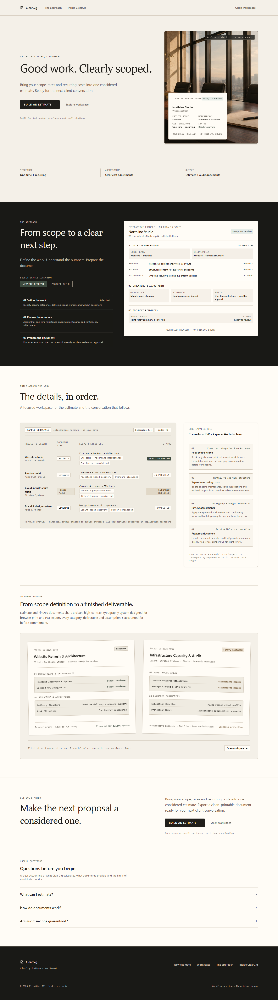

# ClearGig

> **A project estimation and FinOps audit tool for software engineering contractors.**
> Calculate project scopes, hourly rates, contingency buffers, profit margins, and cloud cost optimization scenarios with branded, printable documents.



---

## ✨ Application Routes & Capability Boundaries

ClearGig provides a public portfolio showcase alongside functional contractor estimating tools:

| Route | Role | Description & Data Boundaries |
|---|---|---|
| `/showcase` | **Public Portfolio Showcase** | Public presentation route demonstrating contractor scope estimation, workstreams, interactive sample scenarios (`Website refresh`, `Product build`), and document previews. **Strictly price-free**: zero currency figures, rates, or dollar totals; renders completely static markup with no backend API dependency on initial paint. |
| `/` | **Estimate Creation Wizard** | Five-step guided creation flow: `1. Client identification → 2. Project title → 3. Estimated scope & shared rate → 4. Review estimate → 5. Estimate saved`. Features client reuse, step-by-step validation, partial-save recovery locks, and storage quota resilience. *(Recurring items are configured in project detail, not within the wizard).* |
| `/dashboard` | **Workspace Overview** | Client ledger and estimate registry displaying project statuses, one-time base sums, and recurring totals. Handles empty states, loading skeletons, and connection retry states without requiring user authentication. |
| `/projects/[id]` | **Project Editor & Audit** | Estimate management with line-item CRUD, inline contingency/profit margin adjustments, status lifecycle transitions (`DRAFT → SENT → ACCEPTED / REJECTED`), and an interactive FinOps audit projection tab. |
| `/projects/[id]/document` | **Printable Estimate** | Branded contractor estimate document with repeated table headers across multi-page page breaks, totals breakdown, and client signature authorization line. |
| `/projects/[id]/document?variant=audit` | **Printable Audit** | Branded FinOps audit document showing 5 projected metrics: monthly savings, optimized monthly spend, annualized savings, contingency fee, and client net first-year savings based on configurable scenario assumptions. *(Illustrative scenario modeling; not historical cloud telemetry or guaranteed financial returns).* |

---

## 🏗️ Architecture

```
┌───────────────────────────┐         HTTPS REST API         ┌───────────────────────────┐         PostgreSQL Connection        ┌───────────────────────────┐
│     Next.js Frontend      │ ─────────────────────────────► │    Express Backend API    │ ───────────────────────────────────► │    PostgreSQL Database    │
│  Next.js 16 (App Router)  │                                │  Node.js Express 5        │                                      │  Local Docker or Managed  │
│  React 19, Tailwind CSS 4 │                                │  Prisma ORM               │                                      │  (e.g. Supabase Free)     │
└───────────────────────────┘                                └───────────────────────────┘                                      └───────────────────────────┘
```

- **Frontend:** Next.js 16 App Router, React 19, Tailwind CSS 4, Geist Sans & Mono. Native scroll and WAAPI motion only (no Three.js, GSAP, Lenis, or custom cursors).
- **Backend API:** Node.js Express 5 REST API using Prisma ORM.
- **Data Persistence:** Relational PostgreSQL database. Client creation, project creation, and line-item creation execute as sequential REST calls with explicit client reuse and partial-save recovery.

---

## 🚀 Local Development & Verification

### Prerequisites

- **Node.js:** Node v24.22.1 (verified for native TypeScript test execution and Next.js 16 production preview)
- **Git**
- **Docker Desktop** (optional, for running local PostgreSQL)

### 1. Clone the repository

```bash
git clone https://github.com/BradleyXiX/ClearGig.git
cd ClearGig
```

### 2. Set up and run the frontend

```bash
cd frontend
cp .env.example .env.local
npm install
npm run dev
```

> The development server starts at `http://localhost:3000`. Navigate to `http://localhost:3000/showcase` to explore the public showcase, or `http://localhost:3000/` for the estimate wizard.

### 3. Run Quality & Verification Gates

From the `frontend/` directory:

```bash
# Type check (must exit 0 with 0 errors)
node node_modules/typescript/bin/tsc --noEmit --incremental false

# Automated tests (99 tests across math, controllers, API resilience, and showcase)
node --test --test-timeout=5000 src/lib/*.test.ts src/services/*.test.ts

# Production build verification
npm run build
```

### 4. Optional: Local Backend & Disposable Database

```bash
# Start local PostgreSQL container
docker compose up -d db

# Start backend service
cd ../backend
cp .env.example .env
npm install
npx prisma migrate dev
npm run dev
```

> Backend runs at `http://localhost:5001`. *Note: `npx prisma migrate dev` executes schema migrations against the configured `DATABASE_URL`; only run this against a local disposable database or designated development instance.*

---

## 🔬 Measured Verification & Performance Summary

Full end-to-end browser, print, and timeline verification was performed against an isolated production preview build (`next start -p 3005`) using Playwright Chromium and Poppler `pdftoppm`:

- **Core Web Vitals (Local Unthrottled Loopback Observations):**
  - **LCP:** Median `256 ms` (LCP candidate: hero image `boardroom-desktop-1200.avif`, candidate rendered area: 280,140 CSS px²; meets <= 2500 ms target).
  - **CLS:** Median `0.0000` (target <= 0.1).
  - **TTFB:** Median `6 ms`.
- **Bundle & Asset Transfer:**
  - Total transferred JavaScript: `158.48 KB` (decoded: `536.87 KB` across 19 resources).
  - Total transferred CSS: `9.01 KB`.
- **Timeline & Interaction Observations (Under Synthetic 4x CPU Slowdown):**
  - Captured CDP performance trace: `2.48 MB` JSON, `10,984 events`, `801 main-thread RunTasks`.
  - Observed 19 main-thread tasks exceeding 50 ms under 4x CPU throttling, with a maximum duration of `821.51 ms` during cold initial page load and script evaluation.
  - Interactive scenario toggling callback latency (`pointerup` to next `requestAnimationFrame` render callback) averaged `108.07 ms` over 6 alternating samples. *(Note: Approximate in-browser callback duration under simulated 4x slowdown; distinct from real-world field INP).*
- **Print & PDF Layout:**
  - Multi-page estimate PDF (40 items, 5 pages): Rendered at 150 DPI with Poppler `pdftoppm`. Repeated table headers verified on all pages; totals and client signature block preserved on page 5 without clipping.
  - Audit PDF: Clean 1-page financial projection summary.
- **Detailed Evidence Dossier:**
  - For full methodology, screenshots, and PDF samples, consult the repository report: [docs/design-v2/integrated-verification.md](./docs/design-v2/integrated-verification.md).

---

## 📖 Technical Documentation

| Document | Description |
|---|---|
| [design.md](./design.md) | **Authoritative Specification:** Considered Work design system, tokens, layout, and motion boundaries |
| [docs/design-v2/integrated-verification.md](./docs/design-v2/integrated-verification.md) | **Current Verification Report:** Comprehensive test evidence, asset metrics, and observed performance limitations |
| [docs/design-v2/START-HERE.md](./docs/design-v2/START-HERE.md) | Redesign packet navigation and architecture boundaries |
| [docs/design-v2/execution-plan.md](./docs/design-v2/execution-plan.md) | 16-task redesign sequence and acceptance criteria |
| [docs/design-v2/assets-manifest.md](./docs/design-v2/assets-manifest.md) | Image asset roles, dimensions, and responsive derivatives |
| [docs/ARCHITECTURE.md](./docs/ARCHITECTURE.md) | System architecture and cloud infrastructure |
| [docs/API_SPEC.md](./docs/API_SPEC.md) | REST API endpoints, schemas, and payload specifications |
| [docs/PRD.md](./docs/PRD.md) | Product requirements and user stories |

---

## 📊 Data Model

```
Client ──< Project ──< LineItem
```

| Model | Key Fields |
|---|---|
| `Client` | `id`, `name`, `email` |
| `Project` | `id`, `title`, `status`, `contingencyPercentage`, `profitMargin`, `clientId` |
| `LineItem` | `id`, `category`, `description`, `estimatedHours`, `hourlyRate`, `isRecurring`, `projectId` |

**Project statuses:** `DRAFT` → `SENT` → `ACCEPTED` \| `REJECTED`  
**Line item categories:** `FRONTEND`, `BACKEND`, `CLOUD`, `MAINTENANCE`

---

## 📬 Contact & Enquiries

Have a question about ClearGig or interested in discussing an implementation? Get in touch with Bradley:
- **Email:** [Bradjohn70@gmail.com](mailto:Bradjohn70@gmail.com?subject=ClearGig%20enquiry)
- **WhatsApp:** [+254 703 966 756](https://wa.me/254703966756?text=Hi%20Bradley%2C%20I%27d%20like%20to%20discuss%20ClearGig.)
- **GitHub:** [BradleyXiX](https://github.com/BradleyXiX)

---

## 📄 License & Distribution Notice

No repository-wide license file is currently present in the root checkout. Existing package-level notices remain applicable (e.g. backend package metadata specifies ISC). A repository-wide license decision must be established separately by the project owner prior to making general distribution or licensing claims.
